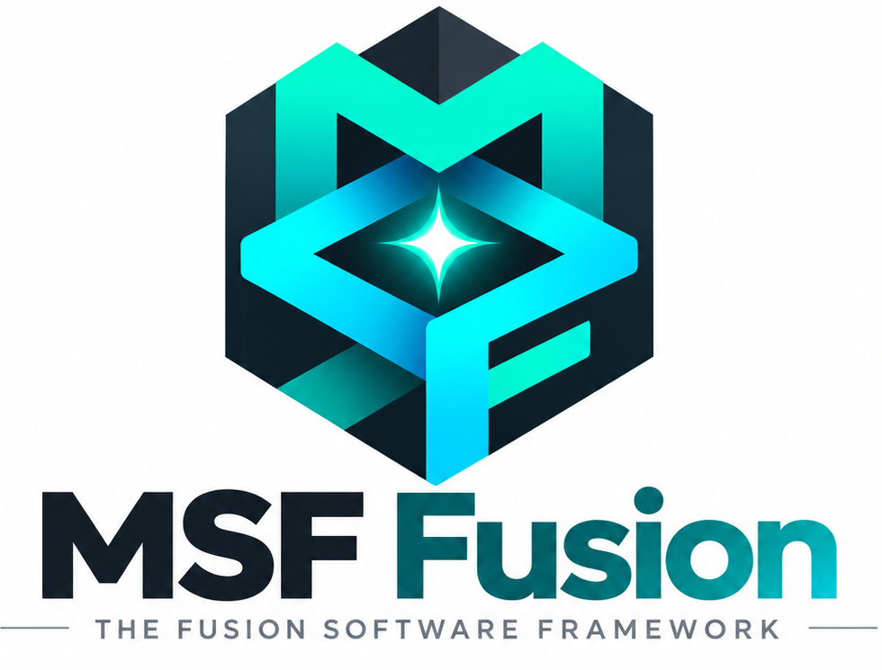

<div align="center">



# MSF Fusion

**A compiler-assisted, fine-grained reactive, TypeScript-first full-stack framework — designed for correctness, performance, and security.**

[-0f766e)](#project-status)
[](https://www.typescriptlang.org/)
[](https://nodejs.org/)
[](https://pnpm.io/)
[](LICENSE)

[Developer Guide](docs/guide/README.md) · [Architecture](docs/architecture/overview.md) · [ADRs](docs/adr/README.md) · [Benchmarks](benchmarks/methodology.md) · [Roadmap](docs/engineering/roadmap.md) · [Implementation Plan](docs/engineering/implementation-plan.md)

</div>

---

## Overview

**MSF Fusion** (Mustafa AI Software Factory — Fusion Framework) is a planned **standalone** framework that owns its reactivity model, compiler, runtime, and server integration. It is not built on, wrapped around, or derived from React, Angular, Next.js, or other framework runtimes.

The project follows an evidence-driven process: architecture decisions, security/performance constraints, reproducible competitor baselines, and compiler feasibility spikes were established before implementation. Milestone 1 is now in progress with a **runnable developer-preview runtime** (reactive kernel, DOM helpers, SSR string renderer) while compiler/JSX, hydration, and dev tooling continue.

## Project status

| Milestone | State | Summary |
|---|---|---|
| **M0 — Architecture & Baseline** | ✅ Completed | ADRs, security/threat model, benchmark lab, final competitor baseline, compiler toolchain spike |
| **M1 — Reactive kernel & compiler slice** | 🚧 In progress | Runtime kernel, DOM helpers, SSR string renderer, tests, and preview example implemented; compiler subset/IR/codegen, dev tooling, and MSF benchmark integration in progress |
| M2+ | 📋 Planned | SSR/hydration, full-stack boundaries, DX, compatibility, hardening |

> **Important:** A **developer-preview runtime** is now implemented (`@msf/runtime`: reactive core, DOM helpers, SSR string render) with tests and an example, but the framework is **not production-ready**: compiler/JSX subset, hydration, dev server/CLI, router, and npm publishing are still in progress/planned. This repository does **not** contain MSF Fusion performance numbers and makes **no superiority claims**.

## What is in this repository today

- **Runtime preview (`packages/runtime`):** real fine-grained reactive kernel (`createSignal`, `createMemo`, `createEffect`, `createRoot`, `batch`, `untrack`, ownership/disposal), DOM helpers (`@msf/runtime/dom`), and SSR string renderer (`@msf/runtime/server`) with tests.
- **Compiler subset (`packages/compiler`):** real `jsx-dom-v1` transform for an intrinsic JSX/TSX subset to DOM runtime calls with diagnostics and tests.
- **Dev tooling preview (`packages/dev`):** compile APIs/CLI (`compilePath`, `status`) for the supported subset.
- **Examples:** `examples/counter-basic` (SSR snapshot) and `examples/counter-browser` (Vite interactive demo).
- **Architecture & decisions:** system/container views, compile-to-runtime pipeline, and ADR-001–ADR-005 with trade-offs and Mermaid diagrams.
- **Benchmark laboratory:** reproducible runner with pinned dependencies, environment capture, raw JSON samples, median/P95/CV/MAD reporting, and equivalent fixtures.
- **Competitor baselines (measured):** React 19.3.1, Solid 1.9.19, Svelte 5.57.3, Vue 3.5.45, and `@preact/signals-core` 1.14.5 (micro primitives where semantically comparable).
- **Compiler toolchain spike:** TypeScript 7 unstable semantic API + Oxc transform feasibility, with recorded evidence.
- **Engineering governance:** threat model, security/performance requirements, risks, quality gates, MVP scope, roadmap, and a detailed approval-gated implementation plan.

**In progress / not yet implemented:** broader IR/sourcemaps and full JSX/component compiler coverage, hydration and isomorphic component model, dev server/HMR, router/full-stack boundaries, publishable `dist` packages, comprehensive MSF benchmark fixtures/runs, and production hardening (M2+). **No MSF Fusion superiority/performance claims.**

## Design principles

- **Fine-grained reactivity:** targeted updates driven by an explicit dependency graph, not VDOM diffing as the primary model.
- **Compiler-assisted:** lowering and diagnostics informed by static analysis, with a framework-owned IR.
- **TypeScript-first:** strong typing as part of the authoring and tooling contract.
- **Full-stack boundaries:** explicit server/client/shared semantics and safe serialization (planned).
- **Evidence over claims:** performance, compatibility, and security assertions require reproducible measurements and tests.

## Repository structure

```text
.
├─ packages/
│  ├─ runtime/                   # Reactive kernel, DOM helpers, SSR renderer (preview)
│  ├─ contracts/                 # Shared interfaces (scaffold)
│  ├─ compiler/                  # Compiler scaffold (IR/codegen pending)
│  └─ dev/                       # Dev tooling scaffold (CLI/HMR pending)
├─ examples/
│  ├─ counter-basic/             # Runnable SSR snapshot example
│  └─ counter-browser/           # Runnable Vite browser example
├─ docs/                         # Architecture, ADRs, guide, security, performance, engineering
├─ benchmarks/                   # Runner, results/reports, evidence, methodology, scenarios
├─ spikes/                       # Milestone 0 feasibility probes
├─ branding/                     # Visual identity assets
└─ .github/                      # CI and community templates
```

## Getting started (developer preview)

**Prerequisites:** Node.js (LTS; v26.x tested), `pnpm@12.21.0`, Git. For DOM benchmarks, Playwright browsers must be installed.

```bash
pnpm install --frozen-lockfile

# Quality checks
pnpm run typecheck
pnpm --filter @msf/runtime run test
pnpm --filter @msf/bench-runner run test
pnpm --filter @msf/spike-compiler-toolchain run test

# Run preview examples
node examples/counter-basic/src/ssr.ts
pnpm --filter @msf/example-counter-browser dev

# Benchmarks (run sequentially for comparable results)
pnpm bench:micro && pnpm bench:ssr && pnpm bench:bundle && pnpm bench:dom && pnpm bench:report
```

See [benchmarks/methodology.md](benchmarks/methodology.md) for fairness rules, exclusions, and interpretation guidance.

## Documentation

| Area | Documents |
|---|---|
| **Developer guide (proposed syntax & usage)** | [Guide index](docs/guide/README.md) · [Getting started](docs/guide/getting-started.md) · [Reactivity](docs/guide/reactivity.md) · [Syntax & components](docs/guide/syntax-and-components.md) · [Full-stack & SSR](docs/guide/fullstack.md) · [FAQ](docs/guide/faq.md) |
| Architecture | [Overview](docs/architecture/overview.md) · [ADR index](docs/adr/README.md) |
| Decisions | [ADR-001 Reactivity](docs/adr/ADR-001-reactivity-model.md) · [ADR-002 Runtime & scheduling](docs/adr/ADR-002-runtime-and-scheduling.md) · [ADR-003 Full-stack boundaries](docs/adr/ADR-003-fullstack-ssr-boundaries.md) · [ADR-004 Compiler toolchain](docs/adr/ADR-004-compiler-toolchain.md) · [ADR-005 Security & performance gates](docs/adr/ADR-005-security-performance-gates.md) |
| Security & Performance | [Security requirements](docs/security/security-requirements.md) · [Threat model](docs/security/threat-model.md) · [Performance requirements](docs/performance/performance-requirements.md) |
| Engineering | [Status](docs/engineering/status.md) · [Risks](docs/engineering/risks.md) · [Gates](docs/engineering/gates.md) · [Roadmap](docs/engineering/roadmap.md) · [MVP scope](docs/engineering/mvp-scope.md) · [Implementation plan](docs/engineering/implementation-plan.md) · [Code review](docs/reviews/architecture-code-review.md) |
| Benchmarks | [Methodology](benchmarks/methodology.md) · [Competitor versions](benchmarks/competitors/versions.md) · [Scenarios](benchmarks/scenarios) |

## Baseline evidence (latest)

- **Raw data:** [`benchmarks/results/2026-11-16_06-39-52-525Z-5om9.json`](benchmarks/results/2026-11-16_06-39-52-525Z-5om9.json)
- **Report:** [`benchmarks/reports/2026-11-16_06-39-52-525Z-5om9.md`](benchmarks/reports/2026-11-16_06-39-52-525Z-5om9.md)
- **Toolchain spike:** [`benchmarks/evidence/compiler-toolchain.json`](benchmarks/evidence/compiler-toolchain.json)

Results are machine- and time-specific. Read [limitations](benchmarks/methodology.md#known-limitations) before interpreting.

## Contributing & governance

- Contributions and implementation work are gated by milestone approval. See [CONTRIBUTING.md](CONTRIBUTING.md) and [Quality gates](docs/engineering/gates.md).
- Security reporting: [SECURITY.md](SECURITY.md)
- Community standards: [CODE_OF_CONDUCT.md](CODE_OF_CONDUCT.md)
- Changes: [CHANGELOG.md](CHANGELOG.md)

## License

No final open-source or commercial license has been selected yet. Until explicitly approved, repository contents are provided under the terms in [LICENSE](LICENSE) (**all rights reserved, pending approval**). Package metadata currently declares `UNLICENSED`.

---

<details>
<summary><strong>ملخص بالعربية</strong></summary>

**MSF Fusion** إطار عمل مستقل (تفاعلية دقيقة بمساعدة المترجم، TypeScript أولاً، كامل المكدس) دون اعتماد على React/Angular/Next.  
**الحالة الحالية:** المرحلة 0 مكتملة ومرحلة M1 قيد التنفيذ بوجود **معاينة مطوّر قابلة للتشغيل** (`@msf/runtime`: نواة تفاعلية + DOM helpers + SSR نصي) مع اختبارات وأمثلة (`counter-basic`, `counter-browser`).  
**غير مكتمل بعد:** المترجم/JSX subset وIR/codegen، hydration والنموذج الموحّد، CLI/HMR، بناء `dist` للنشر، وقياسات أداء لـ MSF Fusion (ولا توجد ادعاءات تفوق).  
راجع [حالة المشروع](docs/engineering/status.md)، [الخارطة](docs/engineering/roadmap.md)، و[مراجعة المعمارية والكود](docs/reviews/architecture-code-review.md).

</details>
