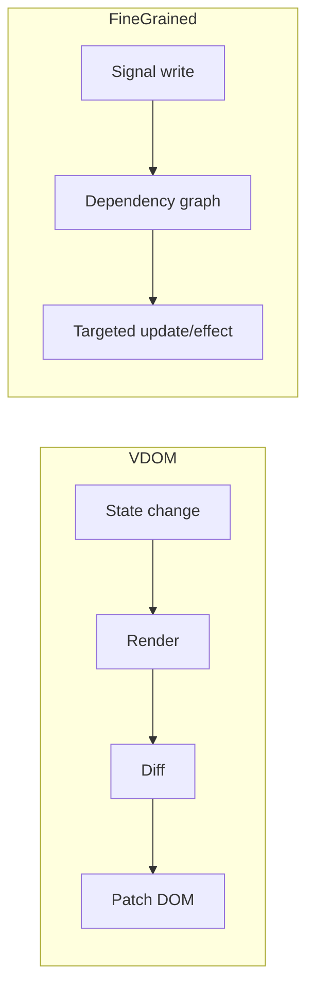

# ADR-001: Compiler-assisted fine-grained reactivity

- **Status:** Proposed (Milestone 0)
- **Date:** 2026-11-16
- **Deciders:** MSF Fusion architecture review (pending approval)

## Context
MSF Fusion must own its reactivity model and compete on correctness, predictability, and measured performance. Competitors use different models: React schedules VDOM reconciliation (with optional compiler optimizations), Solid uses fine-grained signals, Svelte compiles reactivity, Vue combines proxy reactivity with a VDOM/runtime scheduler, Angular uses signals/effects in a framework context, Qwik emphasizes resumability.

## Decision
Adopt a **compiler-assisted, fine-grained reactive** model:
- Authoring syntax expresses state, derived values, effects, and UI bindings.
- Compiler lowers reads/writes to explicit dependency graph operations and static DOM/update sites where safe.
- Runtime executes a small signal/effect/scheduler kernel with deterministic ownership and disposal.
- VDOM diffing is not the primary update mechanism; targeted DOM operations are preferred.

## Alternatives considered
| Option | Pros | Cons | Why not (now) |
|---|---|---|---|
| VDOM-first runtime | Familiar model, flexible dynamic trees | Diff overhead, harder to guarantee fine-grained updates, overlaps React mental model | Conflicts with ownership/perf goals; higher risk of copying patterns |
| Pure runtime signals, minimal compiler | Simpler compiler, dynamic flexibility | Misses static optimization, larger runtime overhead, weaker diagnostics | Leaves measurable wins on table; TS-first ergonomics weaker |
| Svelte-like compile-away runtime | Very small runtime possible | Complex transform semantics, debugging/source-map burden, edge cases | Valuable ideas, but MSF needs explicit runtime kernel for full-stack/interop control |
| Resumability-first (Qwik-like) | Excellent startup/resume story | Serialization complexity, different mental model, high implementation risk early | Defer as strategy, not default Milestone 1 kernel |

## Consequences
- **Positive:** precise updates, analyzable dependency graph, good fit for benchmarks and compiler diagnostics.
- **Negative:** compiler complexity, source-map/debugging requirements, need strong semantics for dynamic cases.
- **Risks:** unsound optimizations, memory leaks from ownership bugs, hard-to-debug compiled output.

## Evidence inputs
- Competitor baseline lab (micro/SSR/bundle/DOM) provides comparison points, not proof of MSF superiority.
- Official models reviewed: Solid fine-grained reactivity, Svelte `$state`, Angular signals, React Compiler intent, Qwik resumability.

## Mermaid — model comparison

## ملخص بالعربية
القرار المقترح: نموذج تفاعلي دقيق بمساعدة المترجم (تحديثات مستهدفة عبر رسم اعتماد) بدلاً من VDOM كآلية أساسية، مع قبول تعقيد المترجم مقابل دقة الأداء والقابلية للتحليل.
