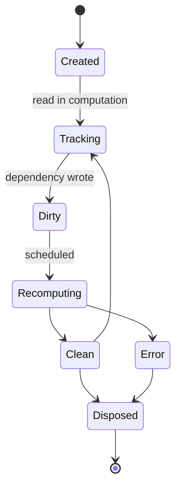

# ADR-002: Runtime ownership, scheduling, and lifecycle

- **Status:** Accepted direction (partially implemented)
- **Date:** 2026-11-16
- **Updated:** 2026-11-16 (M1 kernel preview: signals/memos/effects, ownership/disposal, batch/untrack)

## Context
Fine-grained reactivity requires clear rules for ownership, disposal, batching, and effect ordering. Leaked subscriptions, non-deterministic updates, and scheduler surprises are common failure modes.

## Decision
- **Primitives:** `signal`, `computed/memo`, `effect`, `resource` (async) as internal/runtime concepts; public API names TBD.
- **Ownership tree:** every reactive node is created in an owner scope; disposal cascades deterministically.
- **Scheduling:** synchronous propagation for correctness by default, with explicit batching APIs and a scheduler boundary for UI coalescing; no hidden async behavior.
- **Effects:** classified (sync user effect, render/layout effect, cleanup) with documented timing guarantees.
- **Dev mode:** cycle detection, read/write-after-dispose warnings, and ownership tracing hooks (zero/low cost in prod builds).

## Trade-offs
| Choice | Benefit | Cost |
|---|---|---|
| Deterministic disposal | Prevents leaks, predictable tests | Requires discipline in dynamic structures |
| Explicit batching | Avoids accidental multi-flush | Slightly more verbose advanced code |
| Small kernel | Auditability, bundle control | More compiler/runtime co-design work |

## Lifecycle diagram

## Consequences
- Enables benchmarkable primitives and leak checks.
- Requires rigorous unit/property tests and long-run memory scenarios before claims.

## Implementation note (M1)
`@msf/runtime` implements core primitives with ownership/disposal and synchronous batched propagation in preview form. **A runaway-update depth guard exists** (throws `MSF_REACTIVE_CYCLE` when `updateIfNecessary` nests beyond `MAX_REACTIVE_DEPTH`, 1000) with tests, catching circular chains and pathological recursion. Full dev-mode read/write-after-dispose tracing, effect classification guarantees, and ownership tracing hooks remain pending.

## ملخص بالعربية
يعتمد وقت التشغيل على ملكية هرمية وتخلص حتمي وجدولة واضحة وتأثيرات مصنفة، مع أدوات تطوير لكشف التسريبات والحلقات.
