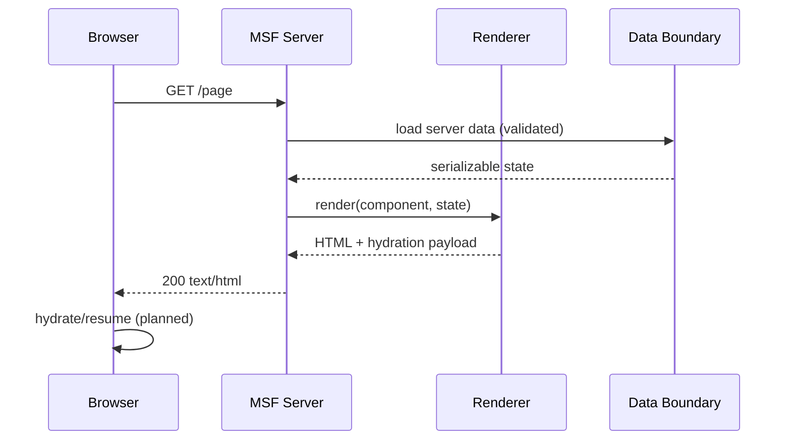

# ADR-003: Full-stack rendering and data boundaries

- **Status:** Accepted direction (preview slice implemented)
- **Date:** 2026-11-16
- **Updated:** 2026-11-16 (SSR string snapshot preview added; hydration/boundaries pending)

## Context
MSF Fusion is full-stack. It must define where code runs (server/client), how data crosses boundaries, how HTML is produced/hydrated or resumed, and how to prevent accidental secret leakage.

## Decision
- **Rendering modes (planned):** static generation, SSR, streaming SSR, and a progressive hydration/resume strategy evaluated after kernel stability. Milestone 1 targets minimal SSR + deterministic client mount before streaming/resume claims.
- **Explicit boundaries:** server-only modules, client-only modules, and shared pure modules enforced by compiler diagnostics and bundler rules.
- **Serialization contract:** only explicitly serializable data crosses server→client; functions, class instances, and secrets rejected by default.
- **Actions/endpoints:** typed request/response handlers with validation at boundary; CSRF/origin/auth hooks designed in.
- **No implicit data fetching magic:** data dependencies are explicit so they can be analyzed, cached, and audited.

## Sequence — SSR request (target)

## Trade-offs
- Explicit boundaries reduce magic but require developer learning.
- Streaming/resume deferred until correctness/security baselines exist.

## Implementation note (M1)
`@msf/runtime/server` provides `h`, `renderToString`, and HTML escaping for a restricted snapshot model. Isomorphic component rendering, hydration, streaming/resume, serialization contracts, and compiler-enforced boundaries are not implemented yet.

## ملخص بالعربية
يحدد القرار حدود تنفيذ واضحة (خادم/عميل/مشترك)، تعاقد تسلسل آمن، ومسار SSR تدريجي مع تأجيل البث والاستئناف إلى ما بعد استقرار النواة.
