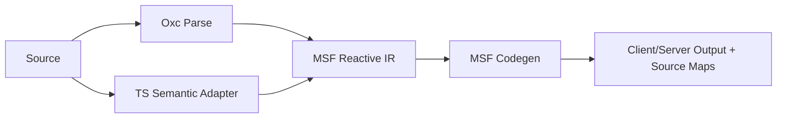

# ADR-004: Compiler toolchain — Oxc parse/transform + TypeScript semantic adapter

- **Status:** Proposed
- **Date:** 2026-11-16
- **Evidence:** `spikes/compiler-toolchain/`, `benchmarks/evidence/compiler-toolchain.json`

## Context
MSF Fusion needs fast parsing/codegen, accurate TypeScript semantics, JSX/TSX handling, and source maps. TypeScript 7.0.2 is pinned; its stable programmatic transform API is not the same as legacy `ts.createProgram` workflows, and the available APIs are exposed under `unstable/*` as a client/server protocol. Oxc provides high-performance parsing and transforms.

## Spike findings (measured feasibility, not benchmark)
| Probe | Result |
|---|---|
| TypeScript root exports | version-only (`version`, `versionMajorMinor`) |
| `typescript/unstable/ast` | scanner/AST utilities available (e.g. `createScanner`, `formatSyntaxKind`) |
| `typescript/unstable/sync` | `API/Project/Program/Checker/Emitter` available; spawned native server, opened fixture project, returned semantic diagnostics for deliberate errors |
| Oxc `oxc-transform-react` (pinned) | TS stripping, classic JSX pragma transform, JSX preserve, source map generation succeeded for probe cases |
| Caveats | TS unstable APIs may change in minor releases; scanner EOF handling differs from legacy enum constant; `oxc-transform-react` is React-specific and must not become MSF runtime dependency — use as feasibility signal only |

## Decision
- **Parse/print/low-level transforms:** Oxc-based pipeline for speed and source-map support.
- **Semantic/type analysis:** TypeScript semantic adapter behind an internal interface, initially using `typescript/unstable/sync` in isolated tooling processes where needed; design for replacement when stable TS 7+ APIs mature.
- **IR boundary:** compiler frontend produces a framework-owned Reactive IR; neither Oxc AST nor TS nodes leak across package boundaries.
- **No React compiler dependency:** `oxc-transform-react` is used only as a spike/dev reference; MSF compiler will own its transforms.

## Alternatives considered
| Option | Pros | Cons |
|---|---|---|
| TypeScript-only compiler pipeline | One semantic source of truth | Slower parse/emit path, API instability/limitations, harder custom transforms |
| SWC/Oxc-only without TS semantics | Fast, simpler deps | Weak type-aware diagnostics and unsafe optimizations |
| Babel-based transforms | Mature plugin ecosystem | Performance and ownership concerns; not aligned with Vite 8/Oxc direction |

## Mermaid — toolchain boundary

## Consequences
- Need adapter layer and version-pinning policy for unstable TS APIs.
- Need custom MSF transforms; spike de-risks syntax/emit feasibility only.

## ملخص بالعربية
القرار: استخدام Oxc للتحليل/التحويل السريع ومحوّل دلالي مبني على TypeScript خلف واجهة داخلية، مع IR مملوك للإطار وعزل واجهات TS غير المستقرة، استناداً إلى نتائج تجربة الجدوى.
