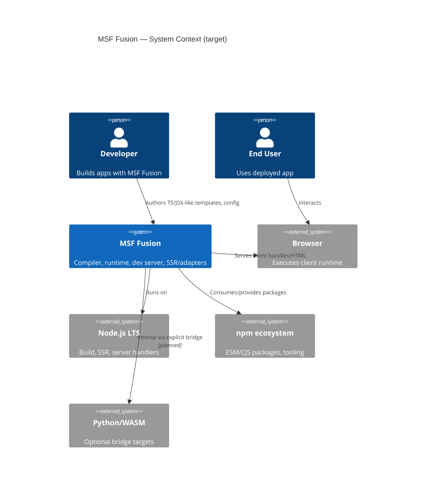
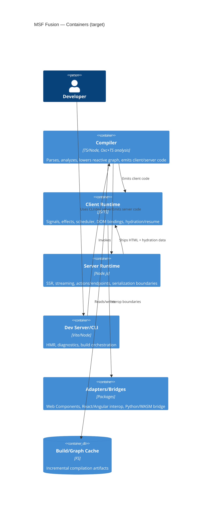
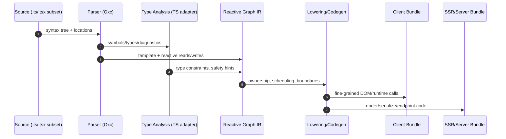
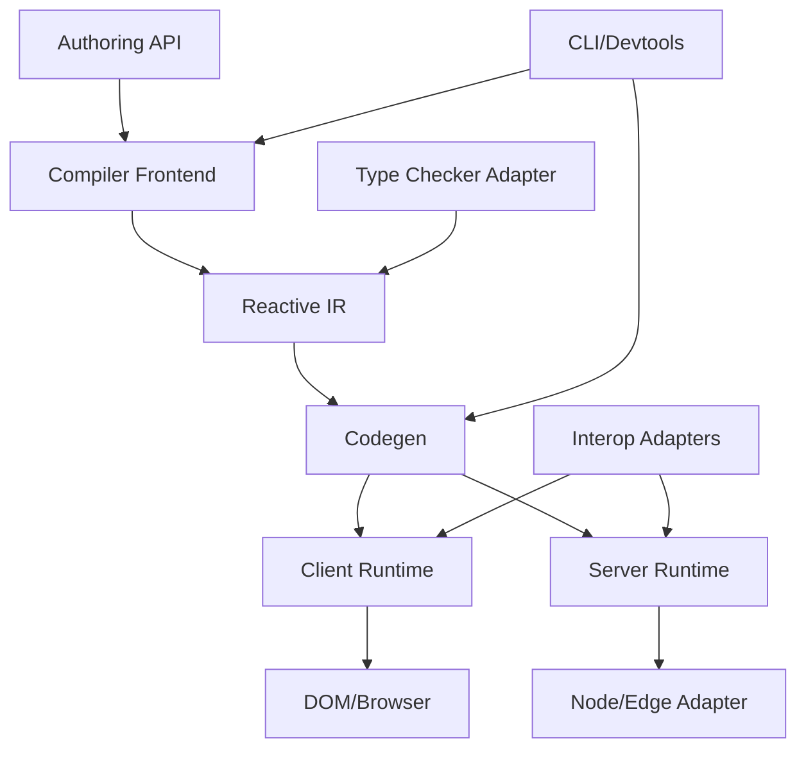

# Architecture overview — MSF Fusion

## Vision
MSF Fusion aims to be a **standalone** web framework that owns its reactivity, compiler, runtime, and server integration. It must not depend on or wrap React, Angular, Next.js, or copy their source. Compatibility is provided through adapters/bridges built on MSF Fusion primitives, not by embedding competitor runtimes.

## Core principles
1. **Compiler-assisted, runtime-true:** the compiler lowers declarative authoring into explicit fine-grained reactive operations; the runtime does not emulate VDOM diffing as the primary update model.
2. **Fine-grained reactivity:** state changes propagate to precise computations/effects/DOM bindings with predictable ownership and disposal.
3. **TypeScript-first:** types are part of the public contract (APIs, compiler diagnostics, generated outputs) while runtime behavior remains correct in plain JS builds.
4. **Full-stack by design:** client, SSR, hydration/streaming/resume strategy, data boundaries, and server handlers share one model and security posture.
5. **Evidence over claims:** performance, compatibility, and security assertions require reproducible measurements/tests.

## Current implementation status (M1 in progress)
| Component | Target | Current state |
|---|---|---|
| Reactive kernel | signals/memos/effects, ownership/disposal, batching | **Implemented (preview):** `packages/runtime/src/core.ts` with tests |
| DOM runtime | fine-grained bindings, control flow, keyed updates | **Partial (preview):** `packages/runtime/src/dom.ts` (insert/attrs/events, basic keyed `list`) |
| SSR | render-to-string, hydration/streaming | **Partial (preview):** `packages/runtime/src/server.ts` (`h`, `renderToString`, escaping); no hydration/isomorphic components |
| Compiler | parse/analyze/IR/codegen, JSX subset, sourcemaps | **Scaffold only:** `packages/compiler` (not implemented) |
| Dev tooling | CLI, HMR, diagnostics | **Scaffold only:** `packages/dev` (not implemented) |
| Contracts | shared IR/interfaces | **Scaffold:** `packages/contracts` |
| Benchmarks (competitors) | reproducible baselines | **Implemented:** `benchmarks/runner` + final baseline evidence |
| MSF benchmark integration | equivalent MSF fixtures/measurements | **Pending** |

See [engineering status](../engineering/status.md) and [architecture/code review](../reviews/architecture-code-review.md) for details and risks.

## System context (C4 L1)

## Container view (C4 L2, target)

## Compile-to-runtime pipeline (sequence, target)

## Dependency direction (target and current rule)

**Rule:** runtime packages must not import compiler internals; compiler depends on shared IR/contracts only. Adapters depend on public runtime/compiler surfaces.

## Key architectural decisions
- ADR-001: Compiler-assisted fine-grained reactivity over VDOM-first runtime
- ADR-002: Signals/ownership model and scheduling boundaries
- ADR-003: Full-stack data/serialization boundary and SSR strategy
- ADR-004: Compiler toolchain split (Oxc parse/transform + TypeScript semantic adapter)
- ADR-005: Security/performance as non-negotiable constraints

## ملخص بالعربية
يوثّق هذا المستند المعمارية المستهدفة لـ MSF Fusion والحالة الحالية: نواة تفاعلية وطبقة DOM/SSR أولية **منفذة كمعاينة**، بينما المترجم وIR/codegen وCLI/HMR والنموذج الموحد والترطيب ما زالت قيد التنفيذ وفق ADRs والخطة.
