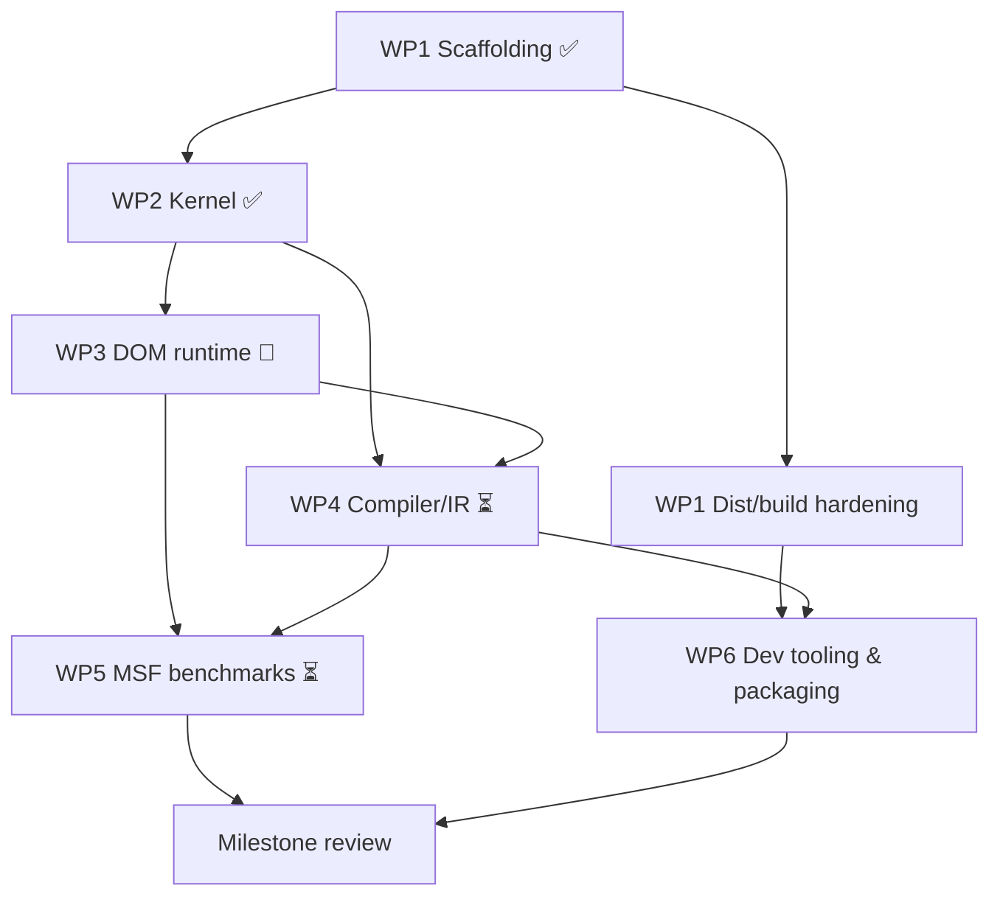

# Implementation plan — Milestone 1 (approved direction, in progress)

> **Status:** M1 execution started under explicit user approval ("موافق"). This plan tracks remaining work and sequencing. Packaging/publishing and license changes still require separate explicit approval.

## 1. Work packages and status

### WP1 — Repository and package scaffolding ✅ Done (baseline)
- [x] Packages: `@msf/contracts`, `@msf/runtime`, `@msf/compiler`, `@msf/dev` with TS configs and scripts
- [x] Workspace integration and dependency direction baseline
- [ ] Publishable builds (`dist`, declaration maps/types, conditional exports)
- [ ] CI expansion for new packages/examples as they stabilize

### WP2 — Reactive kernel (`@msf/runtime`) ✅ Core implemented, hardening pending
- [x] `createSignal`, `createMemo`, `createEffect`, `createRoot`, `batch`, `untrack`, `onCleanup`, owner utilities
- [x] Unit tests for propagation, diamonds, dynamic deps, cleanup, disposal, batching
- [ ] Edge-case hardening: within-run duplicate source tracking, cycle detection/dev diagnostics, clearer error policy, additional stress/leak tests

### WP3 — Minimal DOM runtime 🚧 Partial
- [x] `render`, `insert`, reactive text/attributes/properties/events
- [x] Basic non-keyed `For` and keyed `list` reconciliation helper
- [ ] Robust keyed semantics (multi-root nodes/fragments if supported), control-flow primitives (`Show`/conditional helpers) aligned with compiler targets
- [ ] DOM behavior tests for keyed moves/identity and event/listener cleanup

### WP4 — Compiler frontend + IR + codegen (subset) ⏳ Pending
- [ ] Define minimal reactive IR and supported JSX/authoring subset
- [ ] Parser/transform pipeline (Oxc) + TypeScript semantic adapter boundary per ADR-004
- [ ] Lowering/codegen to runtime/DOM calls with diagnostics and source maps
- [ ] Golden transform tests and unsupported-syntax diagnostics

### WP5 — Benchmark integration for MSF subset ⏳ Pending
- [ ] Add equivalent MSF fixtures only for supported scenarios
- [ ] Run with same methodology (sequential, raw data preserved) and record results without superiority claims
- [ ] Compare against M0 baselines with limitations documented

### WP6 — Dev tooling, docs, and review 🚧 Partial
- [x] Developer guide updated for runnable preview and proposed syntax
- [x] Engineering status and architecture/code review docs
- [ ] `@msf/dev` CLI baseline (`build/check`, dev integration as feasible)
- [ ] API docs for implemented preview surface, examples expansion
- [ ] Milestone review report with evidence and open risks

## 2. Sequencing (updated)

## 3. Definition of done (Milestone 1)
- Supported subset compiles/runs end-to-end (authoring → compiler → runtime/DOM, and preview SSR path where in scope)
- Correctness, disposal, and boundary tests pass; no core behavior mocks
- Benchmark evidence recorded for equivalent scenarios (including neutral/negative results)
- Tooling/docs sufficient for developer preview usage in-repo
- No unresolved critical correctness/security issues in supported subset

## 4. Explicit approvals still required
1. **License choice** before changing `LICENSE` to an open-source/commercial license or publishing under new terms
2. **Publishing/release** (npm, GitHub releases, registries) before any public package release
3. Any scope expansion beyond approved M1 direction (e.g. streaming/resume, adapters/bridges)

## 5. Open questions (to confirm/adjust)
- Package naming/publishing scope if/when approved
- Exact Node/browser support matrix for preview and M1 exit
- SSR/hydration included in M1 exit or deferred to M2 (current: SSR snapshot preview exists; full hydration deferred)
- Initial compiler authoring syntax: **JSX subset** (current assumption) vs alternative

## ملخص بالعربية
الخطة محدثة لتعكس ما نُفّذ في M1 (النواة وDOM/SSR معاينة وأمثلة واختبارات) وما تبقى (تقسية النواة، compiler/IR/codegen، قياسات MSF، أدوات/بناء `dist`، وتوثيق)، مع استمرار اشتراط موافقات منفصلة للرخصة والنشر.
