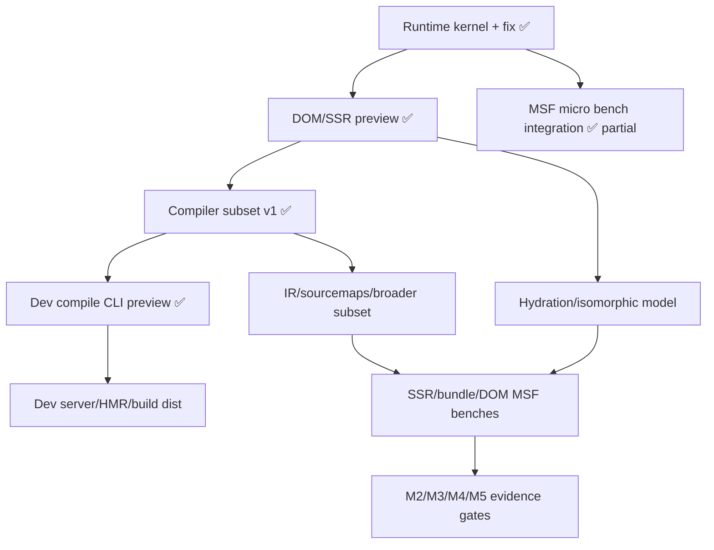

# Implementation plan — M1/M2+ progress (updated)

> **Status:** M1 execution advanced under approved direction. This document tracks completed slices and remaining work. Packaging/publishing and license changes still require separate explicit approval.

## 1. Progress summary

### M1 — Reactive kernel & compiler slice 🚧
**Completed (tested)**
- [x] WP1 baseline scaffolding: `@msf/contracts`, `@msf/runtime`, `@msf/compiler`, `@msf/dev`
- [x] WP2 reactive kernel: signals/memos/effects, ownership/disposal, batching/untracking, cleanup, tests (**21 passing**)
  - [x] Fix: dedupe repeated dependency reads within a single computation run
- [x] WP3 DOM runtime preview: render/insert/bindings/events, keyed `list` helper, SSR `h`/`renderToString` with escaping, tests and examples
- [x] WP4 compiler subset (initial, real): `jsx-dom-v1` transforms intrinsic JSX/TSX subset to DOM runtime calls with diagnostics; tests (**4 passing**)
- [x] WP5 benchmark integration (partial): `msf-runtime` candidate added to micro suite (smoke-verified); competitor baselines preserved
- [x] WP6 dev tooling/docs (partial): dev preview API/CLI (`compileFile`, `compilePath`, `status`), updated docs/status/review

**Remaining for M1 hardening**
- [ ] Broaden compiler subset and add IR/sourcemaps/semantic diagnostics
- [ ] Component model, control flow compilation, and stronger DOM/SSR parity
- [ ] MSF fixtures/measurements for SSR/bundle/DOM with methodology-compliant runs
- [ ] Publishable package builds (`dist`, d.ts, exports) and DX polish
- [ ] Additional edge-case/stress/leak/security evidence

### M2+ — partially started 🚧
- [x] Isomorphic/hydration slice: `@msf/runtime/universal` (isomorphic view descriptors, DOM mount, hydration with mismatch fallback) and `examples/fullstack` pilot (dev SSR via Vite middleware + production prerender + browser-verified hydration)
- [ ] Full component model/context/refs/events and robust control flow primitives
- [ ] Compiler-side lowering to isomorphic view descriptors and hydration markers
- [ ] Streaming/resume evaluation and serialization contracts
- [ ] **M3 Full-stack & DX:** server/client/shared boundaries, actions/endpoints, dev server/HMR, richer CLI/build pipeline
- [ ] **M4 Compatibility:** adapters/interop experiments (evidence-gated), packaging matrix
- [ ] **M5 Hardening & release readiness:** perf/security hardening, migration/docs, approvals for license/publishing

## 2. Sequencing (current)

## 3. Explicit approvals still required
1. **License choice** before changing `LICENSE` terms or publishing under new terms
2. **Publishing/release** (npm, registries, releases) before any public package release
3. Scope/claims for M2+ capabilities must remain evidence-based

## ملخص بالعربية
تم إنجاز واختبار شرائح مهمة من M1 (نواة + إصلاح تتبع، مترجم JSX فرعي، أدوات dev معاينة، دمج micro benchmark لـ MSF). العمل المتبقي يشمل توسيع المترجم/IR، الترطيب والنموذج الموحد، أدوات وخادم dev كاملة، قياسات MSF الشاملة، وبنود M2+ مع بوابات الأدلة والموافقات.