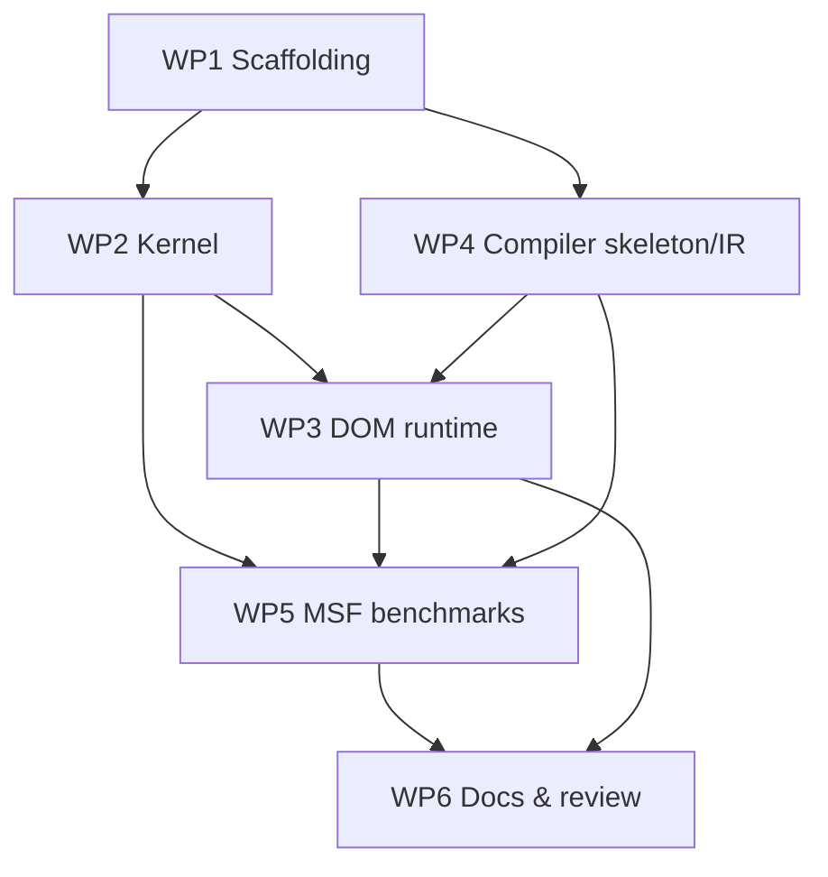

# Implementation plan — for approval (Milestone 1 start)

> **Status:** Proposed. Framework implementation must not start until this plan and Milestone 0 artifacts are explicitly approved.

## 1. Work packages (Milestone 1)

### WP1 — Repository and package scaffolding
- Create packages: `@msf/contracts`, `@msf/runtime`, `@msf/compiler`, `@msf/dev` (names provisional) with strict TS, ESM output, test setup.
- Enforce dependency direction (runtime cannot import compiler).
- **Deliverables:** package manifests, build/test scripts, API entrypoints, lint/type gates.

### WP2 — Reactive kernel (`@msf/runtime`)
- Implement signal/computed/effect primitives, owner/disposal tree, batch, diagnostics hooks.
- Unit tests: propagation correctness, diamonds, dynamic deps, cleanup order, disposal, error boundaries in effects.
- Stress tests: mount/dispose loops and heap sanity checks.
- **Deliverables:** kernel API, tests, internal docs.

### WP3 — Minimal DOM runtime
- Template/DOM binding helpers emitted by compiler: element/text/attr/event, conditional and keyed list updates (minimal set matching benchmark scenarios).
- Tests: DOM equivalence for supported operations, event cleanup, no detached listeners.
- **Deliverables:** DOM module + tests.

### WP4 — Compiler frontend + IR + codegen (subset)
- Parser integration (Oxc) and TS semantic adapter boundary per ADR-004.
- Define minimal Reactive IR and lowering rules for subset.
- Codegen to runtime calls with source maps.
- Golden/transform tests: input → IR/debug → JS output.
- **Deliverables:** compiler package, fixtures, diagnostics for unsupported syntax.

### WP5 — Benchmark integration for MSF subset
- Add MSF fixture(s) to benchmark runner only for equivalent supported scenarios.
- Run and record results with same methodology; do not claim superiority without evidence.
- **Deliverables:** raw JSON/report entries, comparison notes.

### WP6 — Documentation and review
- API docs for subset (EN + AR summaries), architecture updates, ADR amendments if decisions change.
- Milestone 1 review report: completed features, tests, results, limitations, open risks.

## 2. Sequencing and dependencies

## 3. Estimated effort (rough, for planning only)
- WP1: 1–2 days
- WP2: 4–7 days
- WP3: 3–5 days
- WP4: 7–12 days (highest uncertainty: TS adapter + IR)
- WP5: 2–3 days
- WP6: 1–2 days
- **Total:** ~3–6 weeks calendar depending on unknowns; reassess after WP2/WP4 spikes.

## 4. Definition of done (Milestone 1)
- All WP deliverables complete with tests passing in CI-like local run.
- No core behavior mocks; real runtime/compiler execution.
- Benchmark evidence recorded (including cases where MSF is slower/equal).
- Risks/issues documented; no unresolved critical correctness or security defects in subset.

## 5. Explicit approvals required before proceeding
1. Approve Milestone 0 artifacts (architecture, ADRs, security/performance, methodology, baselines, spike evidence).
2. Approve this implementation plan and MVP/M1 scope boundaries.
3. Approve any license choice before adding/changing `LICENSE` or package metadata for publication.
4. Approve any package publishing or production environment changes (none planned in M1).

## 6. Open questions for reviewer
- Preferred package naming/publishing scope (if/when approved)?
- Target Node/browser support matrix for M1?
- Should M1 include minimal SSR string render or defer to M2? (plan assumes DOM-first; SSR can be pulled forward if subset permits.)
- Preferred transform syntax (JSX subset, template literals, or custom directive syntax) for first compiler slice?

## ملخص بالعربية
خطة تنفيذ مقترحة للمرحلة 1: تهيئة الحزم، نواة تفاعلية، DOM أدنى، مترجم/IR لمجموعة فرعية، قياسات مكافئة، وتوثيق، مع تسلسل واعتمادات صريحة مطلوبة قبل البدء.
