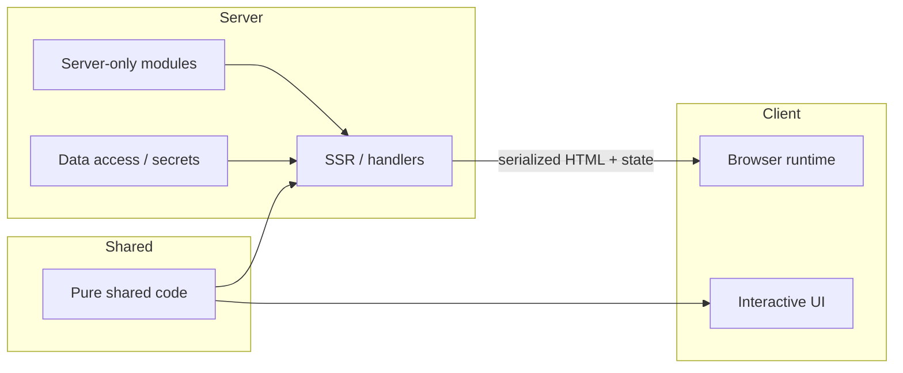

# Full-stack & SSR (Proposed)

> **Proposed / not implemented.** Server runtime, SSR, streaming, hydration/resume, actions, and bundling boundaries are planned capabilities. APIs and guarantees will be defined in approved milestones.

MSF Fusion is designed as a full-stack framework: client rendering, server rendering, data boundaries, and deployment adapters should share one coherent model.

## Execution boundaries



**Planned rules:**
- **Server-only:** can access secrets, databases, private APIs; never bundled to client.
- **Client-only:** browser APIs and interactive-only code.
- **Shared:** pure, serializable-safe logic usable on both sides.
- The compiler/bundler will enforce boundaries and emit diagnostics on violations.

## Server rendering (SSR)

**Goal:** render supported components to HTML on the server with safe escaping by default.

```ts
// Proposed syntax — illustrative
import { renderToString } from "msf/server";
import { App } from "./App";

const html = await renderToString(() => <App url={request.url} />);
```

**Planned:** deterministic output for the supported subset, explicit serialization of hydration data, and clear error boundaries. Streaming SSR and resumability are **deferred** until correctness/security baselines are established (see [roadmap](../engineering/roadmap.md)).

## Hydration / client mount (planned)

After SSR, the client attaches interactivity to server-rendered markup (or adopts a resumability strategy if chosen later). The MVP target is a **deterministic mount/hydration path** for the supported subset with parity tests.

```ts
// Proposed syntax — illustrative
import { hydrate } from "msf/client";
import { App } from "./App";

hydrate(document.getElementById("app")!, () => <App />);
```

## Data loading (planned)

Data dependencies should be explicit, typed, and boundary-aware (no hidden client waterfalls by default).

```ts
// Proposed syntax — illustrative
import { serverQuery } from "msf/server";

export const getUser = serverQuery(async (id: string) => {
  // runs on server only
  return db.user.find(id);
});
```

Exact APIs (queries, loaders, caching, revalidation) will be designed to integrate with SSR, serialization, and security controls.

## Mutations / actions (planned)

```ts
// Proposed syntax — illustrative
import { action } from "msf/server";

export const updateProfile = action(async (input: { name: string }) => {
  // validate input, enforce auth/CSRF, mutate on server
});
```

**Security intent:** origin/method checks, CSRF protection strategy, input validation, and typed request/response contracts at the boundary.

## Serialization contract (planned)

Only explicitly serializable data may cross from server to client (e.g. JSON-compatible values, typed records). Functions, class instances, secrets, and non-serializable handles will be rejected by default with diagnostics.

## Routing (future)

A file-based or config-based router is out of M1 MVP unless re-approved. When introduced, it will integrate with SSR, data loading, and code splitting.

## Deployment (future)

Target adapters (Node, edge runtimes, serverless) will be evaluated after core runtime/SSR semantics stabilize. No deployment claims are made in M0.

## ملخص بالعربية
التصميم كامل المكدس المقترح يفصل حدود الخادم/العميل/المشترك، ويدعم SSR وترطيباً حتمياً (لاحقاً) مع تحميل بيانات وأفعال خادم صريحة وعقود تسلسل آمنة. جميع واجهات البرمجة هنا **مقترحة وغير منفذة**، والبث والاستئناف مؤجلان.
