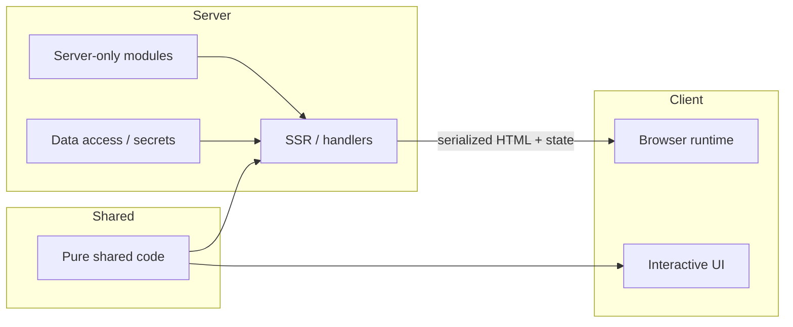

# Full-stack & SSR

> **Status:** A **minimal SSR string renderer** is implemented in preview (`@msf/runtime/server`: `h`, `renderToString`, `escapeHtml`). Full-stack boundaries, hydration, streaming/resume, routing, data/actions, and compiler-enforced modules are **planned**.

## Implemented now (preview)

```ts
import { createSignal } from "@msf/runtime";
import { h, renderToString } from "@msf/runtime/server";

const html = renderToString(() => {
  const [count] = createSignal(0);
  return h("main", null,
    h("h1", null, "Hello MSF"),
    h("p", null, "Count: ", count()),
  );
});
```

- Renders a restricted node shape (`ServerNode` / `h()` elements) to HTML.
- Escapes text and attribute values by default; event handler props are not emitted.
- Uses `untrack` to render a snapshot without reactive subscriptions.

**Not implemented yet:** hydration, component model parity with DOM runtime, streaming, resumability, server/client/shared boundary enforcement, typed actions/queries, routing.

## Planned model (target)



Planned capabilities include: compiler-enforced boundaries, deterministic hydration for a supported subset, explicit serialization contracts, server actions/queries with validation and security controls, and later streaming/resume evaluation based on evidence.

## ملخص بالعربية
المتوفر حالياً: توليد HTML نصي (snapshot) مع هروب افتراضي عبر `@msf/runtime/server`. غير متوفر بعد: الترطيب، النموذج الموحد مع DOM، البث/الاستئناف، وتطبيق حدود الخادم/العميل بالمترجم—وهي أهداف مخططة.