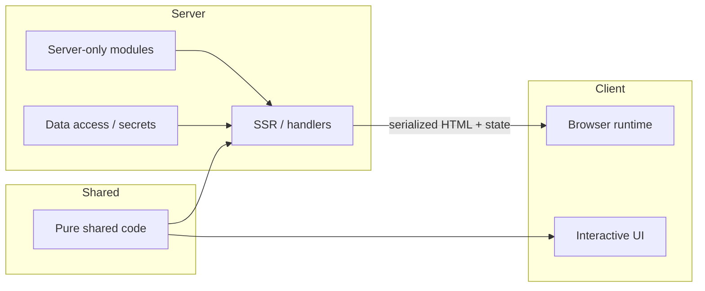

# Full-stack & SSR

> **Status:** A working **SSR snapshot renderer** exists (`@msf/runtime/server`), plus an **isomorphic view layer** (`@msf/runtime/universal`: `h`, `fragment`, `text`, DOM `mount`, `hydrate` with mismatch fallback) that supports **function components**. The `examples/fullstack` pilot demonstrates dev SSR, production prerender, and Chromium-verified hydration. Streaming, resume, routing, data/actions, and compiler-enforced boundaries remain **planned**.

## Implemented now (preview)

**SSR snapshot (string):**
```ts
import { createSignal } from "@msf/runtime";
import { h, renderToString } from "@msf/runtime/server";

const html = renderToString(() => {
  const [count] = createSignal(0);
  return h("main", null,
    h("h1", null, "Hello MSF"),
    h("p", null, "Count: ", () => count()),
  );
});
```

- Fast server-side snapshot with HTML escaping by default.
- Function components supported via `h(MyComponent, props, ...children)`.

**Isomorphic view layer (mount/hydrate):**
```ts
import { h } from "@msf/runtime/server";
import { mount, hydrate } from "@msf/runtime/universal";
import { renderToString } from "@msf/runtime/server";

function Counter({ initial = 0 }) {
  const [count, setCount] = createSignal(initial);
  return h("section", null,
    h("p", null, () => `Count: ${count()}`),
    h("button", { onClick: () => setCount((n) => n + 1) }, "Inc"),
  );
}

// Server
const html = renderToString(() => h(Counter, { initial: 5 }));

// Client (hydrate SSR markup or mount fresh)
mount(() => h(Counter, { initial: 5 }), container);
hydrate(() => h(Counter, { initial: 5 }), container);
```

**Same component tree, three targets:** CSR `mount`, SSR `renderToString`, client `hydrate` of server markup. `hydrate` adopts existing markup; if markup mismatches it falls back to a fresh mount.

## Planned model (target)



Planned capabilities: compiler-enforced boundaries, deterministic hydration for the full supported subset, explicit serialization contracts, server actions/queries with validation and security controls, and streaming/resume evaluation based on evidence.

## ملخص بالعربية
الإطار يمتلك اليوم SSR snapshot فعلي + طبقة view متطابقة (universal) تدعم الترطيب وتقوم بالاستبدال التلقائي عند عدم تطابق DOM مع المكونات الدالية (Counter hydration مُثبتة في Chrome). ما زال **البث/الاستئناف** و**حدود خادم/عميل/مشترك الملزمة** و**الترجمة التلقائية لـ JSX** و**الموجه** و**إجراءات/استعلامات الخادم** مخططة ولم تُنفذ بعد.