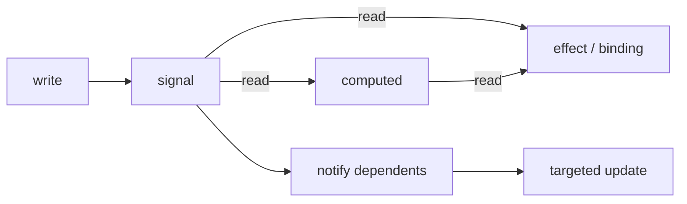

# Reactivity (Proposed)

> **Proposed / not implemented.** Primitives, naming, and semantics described here reflect ADR-001/ADR-002 direction and may change during implementation.

MSF Fusion uses **fine-grained reactivity**: instead of re-running a whole component render and diffing a virtual DOM, reactive reads track precise dependencies and writes update only the computations, effects, or DOM bindings that depend on them.

## Mental model



- **State** lives in signals.
- **Derived state** lives in computed values (lazy/memoized, dependency-tracked).
- **Side effects** live in effects (DOM bindings, logging, subscriptions) with cleanup.
- **Ownership** ensures everything created in a scope is disposed together.

## Signals (state)

A signal holds a value. Reading it inside a tracked context records a dependency; writing it schedules updates for dependents.

```ts
// Proposed syntax — illustrative
import { signal } from "msf/runtime";

const count = signal(0);

count.get();        // read (tracks when called in reactive context)
count.set(1);       // write
count.update(n => n + 1); // functional update (proposed helper)
```

**Design intent:** simple reads/writes, no proxy magic required for primitives, explicit mutation points.

## Computed values (derived state)

Computed values derive from other reactive reads and cache until dependencies change.

```ts
// Proposed syntax — illustrative
import { signal, computed } from "msf/runtime";

const price = signal(100);
const qty = signal(2);
const total = computed(() => price.get() * qty.get());

total.get(); // 200
qty.set(3);
total.get(); // 300 (recomputed because qty changed)
```

**Design intent:** deterministic dependency tracking, no stale derived values, no manual dependency arrays.

## Effects (side effects)

Effects run in response to reactive changes and can return a cleanup function.

```ts
// Proposed syntax — illustrative
import { signal, effect } from "msf/runtime";

const name = signal("Ada");

const dispose = effect(() => {
  console.log("Hello", name.get());
  return () => console.log("cleanup previous");
});

name.set("Lin"); // re-runs effect (after cleanup)
dispose();       // stops tracking and cleans up
```

**Guidelines (planned):** keep effects for synchronization/side effects; prefer computed for pure derivations; avoid writing signals in ways that create unintended cycles (dev diagnostics will flag common cases).

## Ownership and disposal

Every reactive primitive is created under an **owner**. Disposing an owner disposes its children (computeds, effects, nested scopes) deterministically.

```ts
// Proposed syntax — illustrative
import { createRoot, signal, effect } from "msf/runtime";

createRoot((disposeRoot) => {
  const a = signal(1);
  effect(() => console.log(a.get()));
  // ... later
  disposeRoot(); // disposes effect/subscriptions created in this root
});
```

**Why it matters:** prevents memory leaks, makes component unmount behavior predictable, and enables test isolation.

## Batching

Multiple writes can be grouped so dependents update once per batch (API shape TBD).

```ts
// Proposed syntax — illustrative
import { batch, signal } from "msf/runtime";

const first = signal("");
const last = signal("");

batch(() => {
  first.set("Grace");
  last.set("Hopper");
}); // downstream computed/effects flush according to scheduler rules
```

## Scheduling and consistency

- **Default:** synchronous propagation for correctness and predictability.
- **UI coalescing:** framework scheduler may coalesce DOM-facing work at defined boundaries (documented timing guarantees).
- **No hidden async:** async behavior is explicit (e.g. resources/actions), not implicit inside signal writes.

## Resources / async state (planned, later milestone)

Async data will be modeled explicitly (loading/error/value states, cancellation, and integration with SSR boundaries) rather than ad-hoc effects. API details are TBD.

## Dev-mode diagnostics (planned)

- Dependency cycle detection
- Read/write-after-dispose warnings
- Ownership tracing hooks
- Compiler/runtime warnings for common misuse

## ملخص بالعربية
نموذج التفاعلية المقترح يعتمد على `signal` للحالة، و`computed` للاشتقاق، و`effect` للتأثيرات الجانبية، مع **ملكية هرمية** وتخلص حتمي و**تجميع (batch)** وجدولة واضحة. هذه واجهات تصميمية غير منفذة بعد وقد تتغير.
