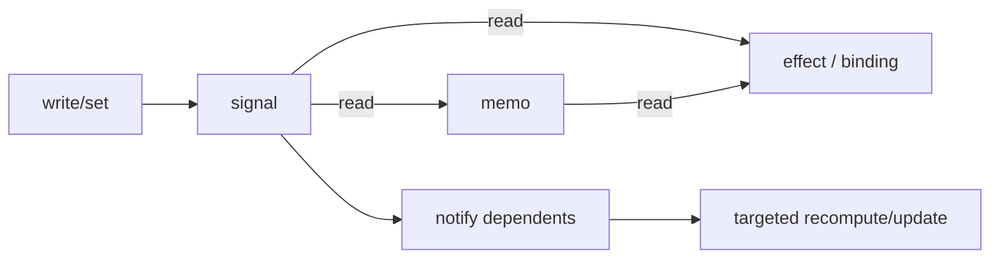

# Reactivity

> **Status:** Core reactive primitives are **implemented in `@msf/runtime` (developer preview)**. Some naming/ergonomics shown in earlier design sketches may differ from the current API and future compiler-facing syntax.

MSF Fusion uses **fine-grained reactivity**: reactive reads track precise dependencies and writes update only affected computations/effects/bindings.

## Implemented API (current preview)

```ts
import {
  batch,
  createEffect,
  createMemo,
  createRoot,
  createSignal,
  onCleanup,
  untrack,
} from "@msf/runtime";

const [count, setCount] = createSignal(0);
const doubled = createMemo(() => count() * 2);

const dispose = createRoot((disposeRoot) => {
  createEffect(() => {
    console.log(count(), doubled());
    onCleanup(() => console.log("cleanup"));
  });
  return disposeRoot;
});

batch(() => {
  setCount(1);
  setCount((n) => n + 1);
});

untrack(() => count()); // read without tracking
dispose();
```

**Function components** are also supported by the isomorphic view layer (`@msf/runtime/universal`):

```ts
import { h } from "@msf/runtime/server";   // or @msf/runtime/universal
import { renderToString } from "@msf/runtime/server";
import { mount, hydrate } from "@msf/runtime/universal";

function Counter({ initial = 0 }: { initial?: number }) {
  const [count, setCount] = createSignal(initial);
  return h("div", null,
    h("p", null, () => `Count: ${count()}`),
    h("button", { onClick: () => setCount((n) => n + 1) }, "Inc"),
  );
}

renderToString(() => h(Counter, { initial: 3 })); // SSR snapshot
mount(() => h(Counter, { initial: 3 }), container);  // CSR mount
hydrate(() => h(Counter, { initial: 3 }), container); // adopt SSR markup
```

### Semantics (current behavior)
- **`createSignal(initial)`** returns `[getter, setter]`. Reading the getter in a reactive computation tracks a dependency.
- **Setter:** accepts a value or updater function (`prev => next`). *Note:* passing a function is treated as an updater in the current implementation; API semantics for storing function values should be treated as preview and may be clarified.
- **`createMemo(fn)`** derives and caches a value; recomputes when tracked dependencies change.
- **`createEffect(fn)`** runs reactively; previous tracked dependencies and registered cleanups are cleared before rerun; disposed with owner/root.
- **`batch(fn)`** groups writes and flushes queued effects after the batch.
- **`untrack(fn)`** reads without dependency tracking.
- **Ownership/disposal:** computations created in a scope are owned and disposed deterministically (`createRoot`, `onCleanup`).

### Current limitations
- No cycle detection/dev diagnostics yet.
- No advanced scheduler priorities or async resources API.
- Edge-case hardening is ongoing (e.g. dependency tracking nuances, error policy, stress/leak evidence).

## Conceptual model



## Proposed authoring ergonomics (not finalized)

Earlier design sketches showed alternative shapes (e.g. `signal().get()/set()` or compiler sugar). The **stable authoring syntax** will be finalized with the compiler/JSX subset. Until then, prefer the implemented primitives above.

## Planned additions
- Dev diagnostics (cycle detection, read/write-after-dispose warnings, ownership tracing)
- Explicit async/resource primitives
- Compiler integration for ergonomic component/template syntax and optimized output

## ملخص بالعربية
النواة التفاعلية **منفذة حالياً** (`createSignal/createMemo/createEffect/createRoot/batch/untrack/onCleanup`) مع تتبع دقيق وملكية/تنظيف حتمي. ما زالت هناك تحسينات لحالات الحافة والتشخيصات، وصياغة المؤلف (compiler ergonomics) ستستقر مع المترجم.