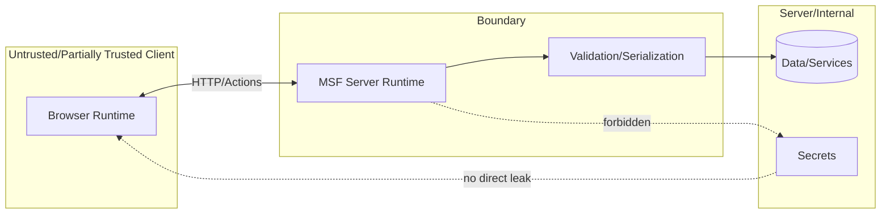

# Threat model — Milestone 0 (initial)

## Assets
- User data and session credentials
- Server secrets, API keys, database access
- Application integrity (correct rendering and state transitions)
- Build artifacts and supply chain integrity

## Trust boundaries

## Key threats and mitigations (planned)

| Threat | Surface | Mitigation |
|---|---|---|
| XSS (stored/reflected/DOM) | Templates, hydration, raw HTML APIs | Contextual escaping, safe defaults, explicit unsafe APIs, tests |
| Secret leakage | Bundles, hydration payloads, logs | Server-only enforcement, serialization allowlist, env scoping |
| CSRF / confused deputy | Server actions/endpoints | Origin checks, tokens/same-site strategy, method enforcement |
| SSRF | Server-side fetch/proxy features | URL validation, deny private/link-local ranges by default, allowlists |
| Prototype pollution / injection | Untrusted JSON/config/input | Schema validation, safe parsing, no unsafe merges |
| Deserialization abuse | Hydration/action payloads | Typed codecs, size limits, reject unknown executable shapes |
| Supply-chain compromise | Dependencies/build/publish | Pinned deps, lockfile, audit gates, provenance (future) |
| DoS / resource exhaustion | Render, compile, actions | Time/memory limits, streaming backpressure, rate limiting hooks |
| ReDoS / algorithmic complexity | Validators/parsers/user patterns | Safe regex practices, input limits, fuzzing for parsers |

## Out of scope (Milestone 0 implementation)
- Production WAF/infra hardening, deployment-specific IAM, and runtime monitoring are consumer/deployment responsibilities (framework must provide hooks and safe defaults).

## ملخص بالعربية
نموذج تهديد أولي يحدد الأصول وحدود الثقة (عميل/خادم/أسرار) والتهديدات الرئيسية مثل XSS وتسريب الأسرار وCSRF/SSRF وهجمات سلسلة التوريد مع تخفيفات مخططة.
